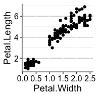

<!-- README.md is generated from README.Rmd. Please edit that file -->

# landscapeR

<!-- badges: start -->

<!-- badges: end -->

An R package to streamline analysis & datavis for a manuscript
describing the multiomic landscape of high risk paediatric cancer

## Installation

You can install the development version of landscapeR from
[GitHub](https://github.com/) with:

``` r
if (!requireNamespace("pak", quietly = TRUE)) {
  install.packages("pak")
}

pak::pak("CCICB/landscapeR")
```

## Quick Start

``` r
library(landscapeR)
library(ggplot2)
library(scales)
#> Warning: package 'scales' was built under R version 4.4.1

# Basic theme for plots
iris |>
  ggplot(aes(x = Petal.Width, y = Petal.Length, colour = Species)) +
  geom_point(shape = 1) +
  theme_landscape2()
```



``` r
# Basic colour schemes
palette_cancer_category() |> preview_palette()
```


``` r
palette_event() |> preview_palette()
```


## Requesting a change

Create a github issue with your request or a PR with the code already
added.

## Saving plots

Ensure all plots are vector graphics and are exported to PDF format
e.g. using `ggplot2::ggsave` or the helper `save_ggplot_as_pdf`. Please
explicitly specify plot dimensions using `width` and `height` argument

``` r
# Create plot
gg <- iris |>
  ggplot(aes(x = Petal.Width, y = Petal.Length)) +
  geom_point() +
  theme_landscape2()

# Print plot
gg

# Save as pdf
save_ggplot_as_pdf(
  gg,
  outdir = "figures",
  prefix = "iris",
  width = 2,
  height = 2,
  units = "in"
)
```
